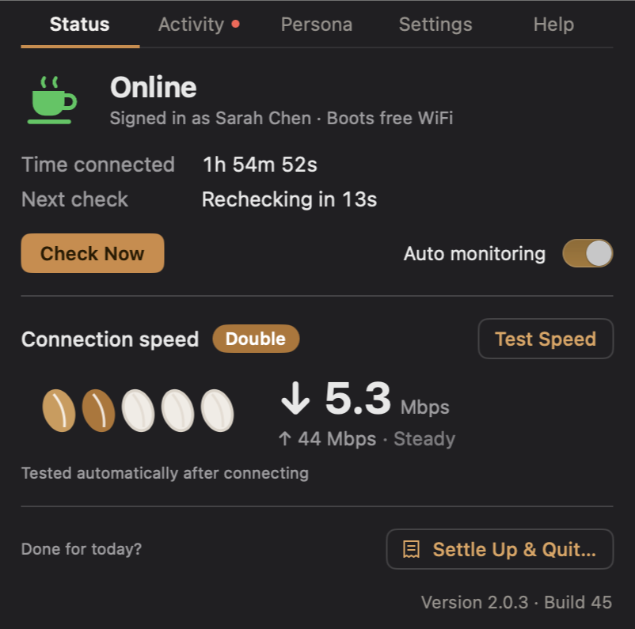
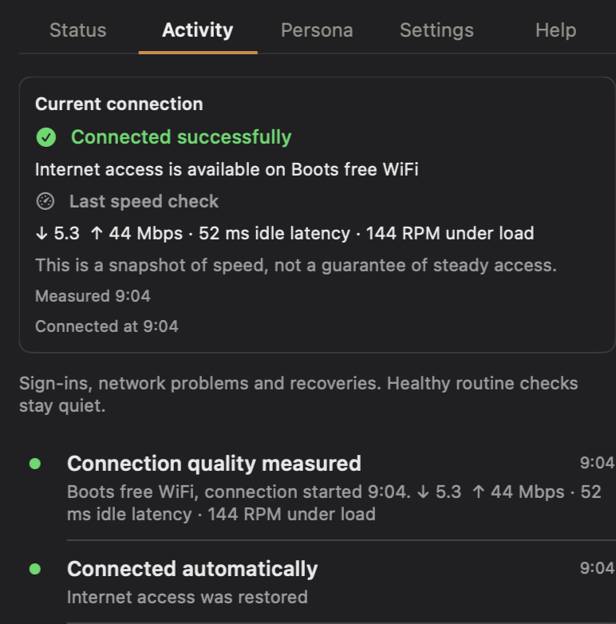
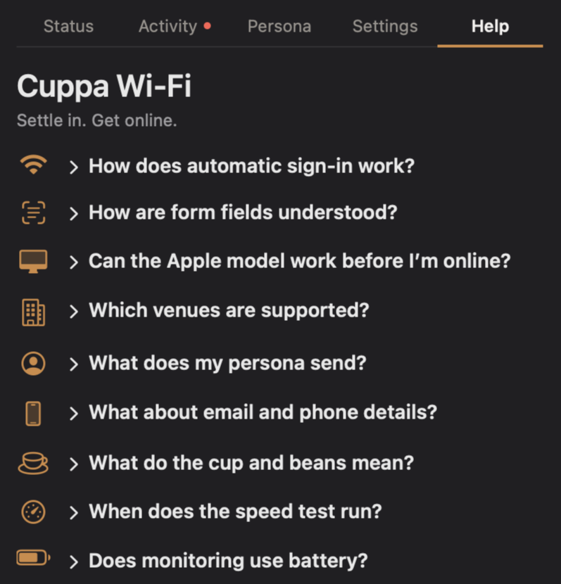
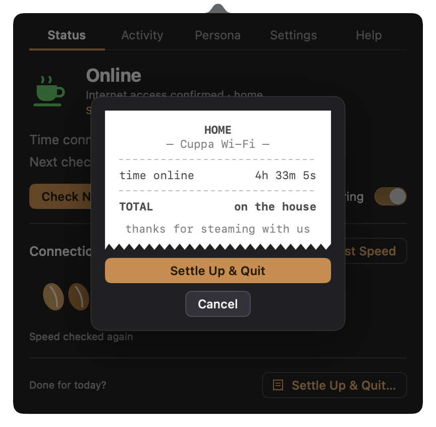

<p align="center">
  
</p>
<h1 align="center">Cuppa Wi-Fi</h1>
<p align="center"><em>Settle in. Get online.</em></p>
<p align="center">
A little Mac menu-bar app that signs you into café and shop Wi-Fi for you — using the AI that's already built into your Mac. No internet needed for the AI.
</p>
<p align="center">
  
  
  
  <a href="LICENSE"></a>
</p>

<p align="center">
  
</p>

## Why

Those Wi-Fi sign-in pages ask the same questions in different forms.
Name, email, date of birth, tick boxes. Sometimes several pages of them.
Cuppa fills them in with a made-up Persona, says no to marketing, and checks you're really online.
The cup steams when you are.

## How it works

1. **Join the Wi-Fi** in your Mac's Wi-Fi menu. Leave Cuppa open.
2. **Cuppa reads the sign-in page.** Simple rules first; Apple's on-device AI for the awkward bits, before you're online.
3. **It checks real internet access.** When the checks pass, the cup steams.

<table>
  <tr>
    <td align="center"><br>Activity: see what happened, and what needs a hand.</td>
    <td align="center"><br>Help: short answers to the common questions.</td>
  </tr>
</table>

## What it won't do

No CAPTCHAs, payment pages, vouchers or access codes, and no paid Wi-Fi.
It only uses a real account login if you've given it one yourself.
**Authorised guest access only.** It stops and asks for help at verification
codes, required marketing and identity checks it doesn't support.
See [the security boundaries](SECURITY.md#project-boundaries).

This is an experiment built for the author's own use, shared in case it helps. No guarantees.

## Privacy

- The AI runs on your Mac. No cloud AI, no API key, no analytics.
- **Cuppa sends the Wi-Fi provider a made-up Persona, not your real details.**
  You can edit it, and use your real details if you'd rather. Cuppa accepts
  required terms and declines optional marketing.
- To check you're online it contacts `captive.apple.com`,
  `connectivitycheck.gstatic.com` and `1.1.1.1`, plus the venue's own sign-in
  page. The optional speed test uses Apple's `networkQuality`.
- Saved data lives in `~/.local/state/wifi-autologin/` and logs in
  `~/Library/Logs/wifi-autologin.log`. It's plain text, not encrypted, so don't
  reuse a valuable password. [How to reset](docs/TROUBLESHOOTING.md#reset-local-data).

More detail: [SECURITY.md](SECURITY.md).

## Get it

**There's no signed download yet**, so for now you build it from source.
You'll need:

- A Mac with Apple silicon (M1 or later).
- For the AI: macOS 26 or later with Apple Intelligence switched on and its
  model downloaded **before** you join guest Wi-Fi. Without it, Cuppa still
  handles ordinary forms with its rules (macOS 13 or later).
- Xcode 16 or later (Xcode 26 or later to build the AI part), Node.js and Git.

```bash
git clone https://github.com/tommyyau/cuppa-wifi.git
cd cuppa-wifi
make app
open "dist/Cuppa Wi-Fi.app"
```

`make app` runs the checks, then builds an ad-hoc-signed app in `dist/`. It
isn't notarised, which is fine for an app you've built yourself. Drag it into
Applications if you like.

**Before first use:** open Persona, put in an email you control (a throwaway is
fine; portals may send mail to it), then Save Persona. Allow Local Network
access when asked. Location permission is optional: it's only used to show the
Wi-Fi's friendly name, and Cuppa doesn't store or send your location.

## Supported portals and limits

Cuppa handles click-through pages, ordinary registration, matching email and
password confirmations, and multi-page forms. It keeps the page's hidden values
and cookies so the sign-in can finish. It can reuse an account it created in
that journey, and remember it after independently verified access, scoped to
the same gateway and portal address.

Provider adapters cover Nando's/Meraki, Wireless Social, Fydelia/UniFi and BT
Wi-Fi guest flows. Generic helpers cover other ordinary forms. A familiar
shop name does not guarantee compatibility at every branch. See
[portal patterns and coverage](docs/PORTAL_PATTERNS.md).

The browser allows 90 seconds, eight actions and twelve page navigations per
journey. AI calls are bounded too. A success page alone never counts as online.
Unusual widgets, rejected fictional details and broken venue networks may need
your help. **Finish sign-in**, when offered, lets you complete the session yourself.
[Field coverage](docs/FIELD_TEST.md) records the remaining acceptance limits.

## Help and development

- [Troubleshooting and everyday use](docs/TROUBLESHOOTING.md)
- [Contributing, build checks and module ownership](CONTRIBUTING.md)
- [Architecture](docs/ARCHITECTURE.md) and [native engine commands](docs/ENGINE.md)
- [Apple model contract](docs/LOCAL_PORTAL_REASONING.md) and [verification guide](docs/VERIFICATION.md)

<p align="center">
  
</p>

## Licence

[MIT](LICENSE). On the house.
