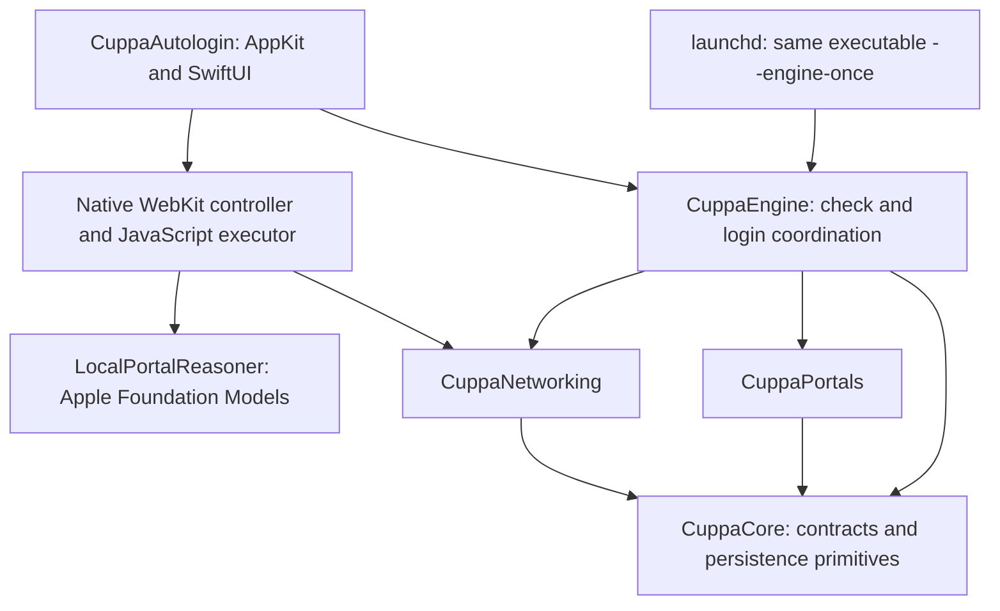

# Cuppa Wi-Fi v2 architecture

Cuppa Wi-Fi is one native macOS application. Its compiled executable can run
as the menu-bar app or as a bounded background check invoked by launchd. No
Python interpreter or Python source is shipped or executed. JavaScript is
retained inside WebKit because DOM observation and interaction belong there.

The app package is `CuppaAutologinApp`; its app target, module and shipped
executable are `CuppaAutologin`. The bundle identifier, launchd label and existing
data paths retain their stable v1 identifiers so upgrades preserve permissions,
preferences and saved accounts. Those compatibility identifiers are not module
names. The installer replaces the old executable path in the existing service
definition, keeping the configured monitoring interval.

## Modules and dependencies

| Module | Owns | Does not decide |
| --- | --- | --- |
| CuppaCore | HTTP request/response and network values; effect protocols; literal Persona parsing; private atomic files; cross-process lock; network identity and dormancy policies | UI, model decisions or network success |
| CuppaNetworking | Interface-scoped TCP/TLS and DNS; bounded HTTP framing, redirects and cookies; connectivity probes; authenticated browser relay; macOS network inspection and diagnosis | Persona fields, consent or automatic-login credit |
| CuppaPortals | Static form parsing, shared schema interpretation, format corrections and reviewed BT/Fydelia/Wireless Social/Nando's exchanges | Whether the internet actually works |
| CuppaEngine | Bounded attempts/retries, progress, stale-network rejection, durable handoffs, independent verification, history/captures and native CLI | Browser DOM or language-model generation |
| CuppaAutologin | Menu-bar UI, preferences, WebKit lifecycle, saved accounts and direct Apple-model integration | Trusting a portal's success page as proof of access |

Sources live under `macos/CuppaAutologinApp/Sources/`. Native unit and integration
tests live in the corresponding `Tests/Cuppa*Tests` directories. The small
`CuppaFixtureServer` executable is test infrastructure and is never shipped.
Canonical schema, provider profiles and correction rules live in `macos/Resources`.
Shared synthetic fixtures live separately in `macos/TestFixtures/Portal` and are
never shipped. The v1 reference implementation is archived privately; this checkout has
one maintained implementation. Each reviewed provider has its own
Swift file (`BTWiFiPortal`, `FydeliaPortal`, `WirelessSocialPortal`, `NandosPortal`).

## Check and login lifecycle

1. Acquire the shared nonblocking file lock, load the saved Persona and inspect
   the current Wi-Fi route. A check or browser attempt already holding the lock
   owns the connection; overlapping work is skipped.
2. Reconcile gateway, SSID and DHCP identity. A change invalidates the preceding
   venue's result, pending handoff, diagnostic and login credit.
3. Enforce ignored-network, personal-hotspot and non-Wi-Fi dormancy before HTTP.
4. Probe known connectivity endpoints without following redirects. Recognized
   Apple success is sufficient for a routine healthy check. Captive hints and
   post-submission verification require Apple and gstatic to agree.
5. Discover the portal from redirects, the scoped gateway, DNS-independent
   diagnosis or the narrow reviewed macOS captive-log contract.
6. Execute observed static forms or a reviewed provider workflow with cookies,
   hidden tokens and an action/deadline budget. Unfamiliar or JavaScript-driven
   stages become a private WebKit handoff containing session state.
7. Independently verify a candidate submission. A portal response cannot write
   ONLINE; automatic-login credit additionally requires an accepted automatic
   workflow. Assisted completion is recorded separately.
8. Recheck network identity before applying results. Publish private state and
   activity. Captive retries remain bounded; terminal and pending-browser states
   end the retry loop.

The UI calls the same engine in process for Check Now and browser completion.
launchd invokes `CuppaAutologin --engine-once`, watching network configuration
changes and using the saved interval (30 seconds by default). There is no
persistent background interpreter or copied executable in Application Support.

`EngineServiceOperations` runs blocking migration, installation and launchctl
transactions on a dedicated serial queue. `StatusModel` loads Persona and
preferences immediately, owns UI state on the main actor and awaits that queue.
Service, connection-check and access-verification work retain separate busy
state. Duplicate commands and concurrent settings writes are rejected while a
service transaction is pending; browser handoffs wait for it to finish. Quit
waits for service work, confirms monitoring stopped and preserves the saved
preference for the next launch. Installer rollback remains one native transaction.

## Network transport

Native Network.framework connections require the selected interface, preserving
newly joined captive Wi-Fi even when another interface is the default route.
The resolver uses scoped DNS with a bounded fallback to the interface's DHCP
resolvers and gateway. Requests have total deadlines, redirect limits and body
limits; malformed HTTP framing and unavailable interfaces fail closed.

`ConnectivityProbe` recognizes the actual Apple detector document or gstatic
204 response. Arbitrary pages containing the word Success do not qualify.
A lingering macOS WebSheet can coexist with valid internet access; the second
independent probe resolves that ambiguity. No model is involved in network
verification or diagnosis.

On macOS 14+, the browser uses a private WebKit data store and the native
`BrowserRelay`. It listens only on loopback, authenticates CONNECT requests,
binds outgoing traffic and DNS to the captive interface and restricts private
destinations to the observed portal/current gateway contract. TLS remains
between WebKit and the portal. It changes no system proxy settings and disables
direct failover. Cancellation closes the listener and active connections.
macOS 13 retains system WebKit transport because its scoped proxy API is absent.

When normal probes fail, native diagnosis checks the assigned address, gateway
and literal-IP HTTP paths. No reachable portal means no form retries or model
calls. A missing ping alone cannot establish router failure. Repeated matching
observations, spaced by at least 15 seconds and no more than three minutes,
support the persistent network-problem message. Diagnostic evidence is discarded
if the connection changes during collection.

## Browser and model boundary

The existing reviewed `autofill.js` observes real visible controls, fills saved
Persona values, preserves tokens, declines marketing and enforces consent,
verification and credential boundaries. It supports conditional fields, safe
corrections and multi-page account creation/login. It never executes model-
generated code. The native controller enforces eight actions, twelve navigations
and a 90-second window measured from handoff, inspecting usable controls at
interactive document readiness rather than waiting for decorative images.

Scripts, evaluations and native message channels share an isolated WebKit
content world named `CuppaAutofill`. Page JavaScript has no access to those
executor objects or handlers. Frame authorization, account state and correction
keys use WebKit's security origin, including inherited documents. The Persona
password goes only to the main document and same-origin or authorized Persona
signup frames; opaque and third-party frames do not receive it. Explicit account
permission never grants additional Persona-password access. See
[SECURITY.md](../SECURITY.md) for the shared-DOM and other Persona-field limits.
Because a WebKit frame reference survives navigation, the isolated executor also
compares its current origin with the authorized origin immediately before filling.

Both native forms and the browser executor distinguish marketing opt-in from
opt-out questions. They interpret the displayed option label before its server
value and reject disabled or ambiguous answers rather than authorizing consent.

`LocalPortalReasoner.swift` directly calls `SystemLanguageModel.default` through
Foundation Models on supported, model-ready macOS 26 systems. It provides
bounded semantic interpretations and offered IDs, not values, credentials,
URLs or executable code. Availability and each response are checked. The model
is optional and has no cloud backend. See [the reasoning contract](LOCAL_PORTAL_REASONING.md)
for guided schemas, time limits, metadata scrubbing and actual-inference tests.

Existing accounts require explicit or independently verified authorization.
Remembered credentials are scoped to a non-shared gateway and exact origin;
shared virtual router MACs cannot identify a venue. Credentials remain outside
model observations and structural journey reports. An assisted sign-in cannot
create automatic-login credit or a learned automatic strategy.

## Persistence, migration and evidence

The native engine reads the existing `identity.env` as literal data, never as
shell input. The app preserves Persona drafts versus saved values. v1 private
paths and record formats remain compatible; unknown state fields survive and
v2 writes `engine_version: 2`. First launch replaces the background command with
the same native app executable while preserving saved intervals and monitoring
preferences. A legacy per-copy Persona is migrated only if shared data is absent.

Private writes create mode-0600 temporary files before any sensitive bytes and
atomically rename them. Captures/directories are private. State, handoff and
browser operations share the same lock. Raw captures may contain tokens and
must be reviewed before sharing; separate structural reports omit body data,
headers, query strings and entered values. Activity logs rotate at 1 MB with
one backup. No AppleScript notification process is launched.

Verified strategies are keyed by host/schema with 30-day validity and a
200-entry limit. They choose an execution path; they do not train the model or
modify code. Structural journey reports retain at most 200 outcomes, distinguish
assisted/automatic and first/returning visits, and record model call/decision
counts. Phone rejection history cannot authorize inventing another number.

Failure forensics collect bounded private network evidence and portal chains,
including a per-resolver DNS matrix, with rate limits and retention. They cannot
authorize login or prove access. A failed background-service upgrade restores
the previous service definition and attempts to restart it; a restart failure
is reported explicitly.
The native CLI exposes status, ignored networks, outcome statistics, triage and
manual diagnostics; see [ENGINE.md](ENGINE.md).

## Validation boundary

Dependencies are injected at network, HTTP, portal, clock, sleep, discovery and
recovery boundaries. Independent engine tests exercise production portal code
against a separate grant-state oracle. Native networking tests exercise actual
loopback sockets, DNS and authenticated relay bytes. Real WebKit fixtures verify
received form values and grants, with actual model calls required in model cases.

The complete acceptance matrix is [MIGRATION_AUDIT.md](MIGRATION_AUDIT.md).
[VERIFICATION.md](VERIFICATION.md) distinguishes baseline, native tests, installed
artifact and field evidence. A passing build or synthetic test does not establish
a new cold join at a real venue. Local releases are ad-hoc signed; public releases
require Developer ID signing and notarization.
